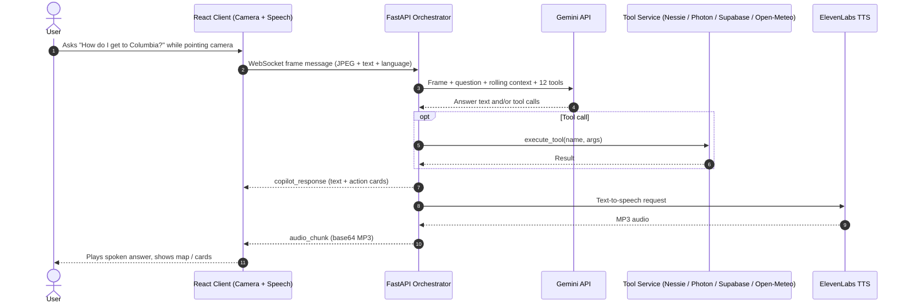

# New Yorker Jarvis Technical Architecture

This document describes how **New Yorker Jarvis** works: system design, data flow, visual state management, sponsor integrations, and deployment.

---

## 1. System Vision & Architecture Philosophy

New Yorker Jarvis is a **hands-free voice-and-camera transit copilot**. Instead of uploading single photos to a chatbot, the user points the phone camera and asks questions out loud:

1. **Voice + Vision per Question:** Every spoken question is sent to Gemini together with the current camera frame, so answers are grounded in what the user is looking at.
2. **Rolling Visual Memory (Temporal Context):** Navigation is sequential:
   $$\text{Street Entrance} \longrightarrow \text{Mezzanine} \longrightarrow \text{Turnstile} \longrightarrow \text{Platform} \longrightarrow \text{Train Boarded}$$
   The backend tracks this with a spatial state machine (`TransitLocationState`) and a rolling memory of the last 10 entries.
3. **Agentic Actions:** Gemini can call 12 tools to pay fares, plan routes, look up alerts, check weather, update a trip plan, or text an itinerary to iMessage.

---

## 2. High-Level System Architecture

```text
┌────────────────────────────────────────────────────────────────────────────────┐
│                       CLIENT TIER (React + Vite + TypeScript)                  │
│                                                                                │
│   ┌─────────────────────┐   ┌──────────────────────┐   ┌───────────────────┐   │
│   │ Camera Frame Sampler│   │ Speech Recognition   │   │  Audio Playback   │   │
│   │ (Canvas, 1.5 FPS)   │   │ (Web Speech, en/ru)  │   │ (Web Audio, MP3)  │   │
│   └──────────┬──────────┘   └──────────┬───────────┘   └─────────▲─────────┘   │
└──────────────┼─────────────────────────┼─────────────────────────┼─────────────┘
               │ base64 JPEG + question text (JSON)                │ base64 MP3
               ▼                         ▼                         │
┌──────────────────────────────────────────────────────────────────┴─────────────┐
│                       BACKEND ORCHESTRATION (FastAPI)                          │
│                                                                                │
│   ┌────────────────────────────────────────────────────────────────────────┐   │
│   │              WebSocket Route  /ws/stream/{session_id}                  │   │
│   └──────────┬─────────────────────────┬─────────────────────────┬─────────┘   │
│              ▼                         ▼                         ▼             │
│   ┌─────────────────────┐   ┌──────────────────────┐   ┌───────────────────┐   │
│   │ Rolling Visual      │   │ Gemini Prompt &      │   │ Text-to-Speech    │   │
│   │ Memory + State Mach.│   │ 12-Tool Dispatcher   │   │ (after answer)    │   │
│   └─────────────────────┘   └──────────┬───────────┘   └─────────┬─────────┘   │
└────────────────────────────────────────┼─────────────────────────┼─────────────┘
                                         │                         │
                ┌────────────────────────┼──────────────┐          ▼
                ▼              ▼         ▼        ▼     ▼   ┌───────────────────┐
           Google Gemini   Nessie    Photon   Supabase Open │    ElevenLabs     │
           (vision +       (balance, (iMessage)(alerts, Meteo│ (eleven_flash_   │
           function calls) payments)          sessions)(weather) v2_5, REST)   │
                                                            └───────────────────┘
```

---

## 3. Core Component Breakdown

### 3.1 Client Layer: React + Vite + TypeScript (Mobile-First)

- **Camera Pipeline:** `getUserMedia()` with the back camera (`facingMode: "environment"`). An off-screen `<canvas>` downscales frames to 640px wide and encodes them as JPEG. In live mode, frames are sampled at **1.5 FPS** (`VITE_FRAME_RATE_FPS`).
- **Speech Input:** The browser Web Speech API recognizes **English (`en-US`) or Russian (`ru-RU`)**. The user switches language by voice (e.g. "switch to Russian").
- **One Turn at a Time:** Only one question is in flight at once; a 15-second timeout releases a stuck turn.
- **Audio Playback:** Plays the base64 MP3 from each `audio_chunk` message via the Web Audio API.
- **HUD:** Map (Leaflet + OpenStreetMap, routes from Transitous and OSRM), trip plan dashboard, action cards, transcript, and a status bar with latency and connection state.

### 3.2 Backend Orchestrator: FastAPI & Python 3.12

- **WebSocket Route (`/ws/stream/{session_id}`):** Receives `frame` messages (image, optional text, language) and `ping` messages; replies with `copilot_response`, `audio_chunk`, and `pong`.
- **Passive vs. Question Frames:** Frames without text are passive and do **not** call Gemini. Frames with text call Gemini with the frame, the question, rolling context and the tools.
- **Rolling Visual Memory:** `deque(maxlen=10)` plus the `TransitLocationState` machine (`STREET_ENTRANCE`, `MEZZANINE`, `TURNSTILE`, `PLATFORM`, `TRAIN_BOARDED`).
- **Agentic Tool Dispatcher:** `execute_tool` in `tools.py` runs Gemini's function calls and returns results as action cards.
- **Graceful Degradation:** Gemini calls are bounded by `GEMINI_TIMEOUT_SECONDS`; a spoken question always gets a reply, even if Gemini fails.

---

## 4. Integrations

### 4.1 Gemini API (Multimodal Vision & Function Calling)
*Track: Best Use of Gemini API [MLH]*

- **Model:** set by `GEMINI_MODEL` (see `backend/.env.example` and `backend/app/config.py`).
- **Multimodal Input:** One camera frame + the user's question + rolling context per request (`generate_content`).
- **12 Function-Calling Tools** (`backend/app/agents/tools.py`):

| Category | Tools |
| :--- | :--- |
| Payments (Nessie) | `check_bank_balance`, `deposit_money`, `pay_with_card` |
| Routing & Map | `set_navigation_route`, `close_navigation_map` |
| Transit Alerts (Supabase) | `lookup_transit_alerts` |
| Weather (Open-Meteo) | `get_weather_forecast` |
| Messaging (Photon) | `dispatch_imessage_itinerary` |
| Trip Plan HUD | `update_mission_plan`, `clear_mission_plan`, `hide_mission_plan`, `show_mission_plan` |

### 4.2 ElevenLabs (Voice Output)
*Track: Best Use of ElevenLabs [MLH]*

- After the text answer is sent, the backend calls the ElevenLabs text-to-speech REST API (`eleven_flash_v2_5`, `optimize_streaming_latency=3`) and sends the MP3 to the client as base64 over the WebSocket.
- `/api/tts?text=...` returns MP3 directly for quick testing.

### 4.3 Photon Spectrum SDK (iMessage)
*Track: Agents in iMessage using Photon [Photon]*

- `dispatch_imessage_itinerary` sends the destination, transit line, steps and any warning as an iMessage.
- Without `PHOTON_API_KEY`, the dispatch is simulated so the demo still runs.

### 4.4 Capital One Nessie API (Transit Payments)
*Track: Best Use of Nessie [Capital One]*

- **Balance:** `check_bank_balance` reads the account and computes a live net balance from deposits and purchases (the Nessie sandbox doesn't update `balance` itself).
- **Deposit & Fare Payment:** `deposit_money` and `pay_with_card` (default merchant: MTA turnstile, $2.90 fare).
- Without `NESSIE_API_KEY`, results are simulated.

### 4.5 Supabase (Transit Alerts & Sessions)

- `lookup_transit_alerts` reads the `livelens_transit_alerts` table by line.
- Session checkpoints are saved to `livelens_sessions`.

### 4.6 Open-Meteo (Weather)

- `get_weather_forecast` geocodes the location and returns an hourly forecast. No API key needed.

### 4.7 DigitalOcean (Hosting)
*Track: Best Use of DigitalOcean [MLH]*

- Hosts the containerized FastAPI backend (`backend/Dockerfile`).

---

## 5. Sequence Diagram: Question & Tool Execution



---

## 6. Security & Privacy

1. **Transient Frames:** Camera frames are processed in memory and never written to disk.
2. **Secrets in Config Only:** All API keys come from `backend/.env` via `config.py` and are never committed.
3. **Graceful Degradation:** Missing keys or failed APIs return simulated or fallback results instead of breaking the session.
